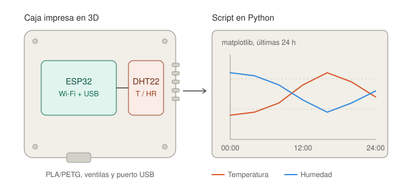
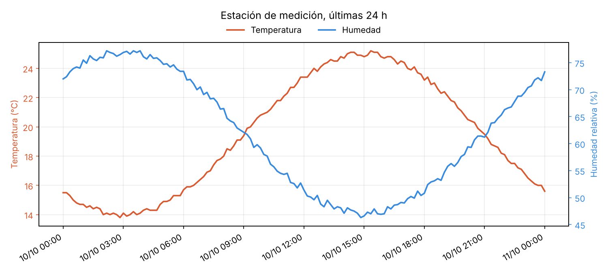

# Estación de medición con ESP32

Estación que registra temperatura y humedad con un ESP32 y un sensor DHT22, guarda las lecturas en un CSV, las grafica con Python y se aloja en una caja diseñada e impresa en 3D.



## Qué incluye

El repositorio tiene tres partes que se pueden usar por separado. En `firmware/` está el programa del ESP32 (PlatformIO, framework Arduino), que lee el DHT22 y publica cada lectura por serial como una línea CSV, con un servidor HTTP opcional por Wi-Fi. En `software/` están los scripts de Python que registran esas lecturas con fecha y hora y arman el gráfico. En `caja/` está el modelo paramétrico en OpenSCAD de la caja, con base, tapa, ventilas frente al sensor y abertura USB.

```
firmware/   programa del ESP32 (PlatformIO)
software/   registrar.py, graficar.py, generar_ejemplo.py
caja/       caja.scad (base y tapa)
datos/      ejemplo.csv (datos simulados) y tus lecturas
docs/       cableado, lista de materiales, mockup
tests/      pruebas de los scripts de Python
```

## Inicio rápido

Conectá el DHT22 al ESP32 según [docs/cableado.md](docs/cableado.md): VCC a 3V3, DATA a GPIO 4 y GND a GND. Después cargá el firmware con PlatformIO:

```bash
pio run -d firmware -t upload
pio device monitor -d firmware
```

En el monitor vas a ver líneas como `12000,23.4,55.1` (milisegundos, °C, % de humedad). Con el ESP32 conectado por USB, instalá las dependencias de Python y registrá las lecturas:

```bash
pip install -r software/requirements.txt
python software/registrar.py --puerto COM3          # en Linux: /dev/ttyUSB0
python software/graficar.py --entrada datos/lecturas.csv --horas 24 --salida grafico.png
```

Para probar el gráfico sin hardware hay datos simulados, no mediciones reales:

```bash
python software/graficar.py --entrada datos/ejemplo.csv --salida docs/grafico_ejemplo.png
```



## Wi-Fi opcional

En `firmware/src/config.h` poné `USAR_WIFI` en `1`, copiá `firmware/src/secrets.example.h` como `secrets.h` y completá tu red. El ESP32 va a responder en `http://<ip>/datos.json`. El archivo `secrets.h` está en `.gitignore`, así que tus credenciales no se suben al repositorio.

## La caja

Abrí `caja/caja.scad` en OpenSCAD, elegí `parte = "base"` o `"tapa"` y exportá a STL (F6 y luego F7). Las medidas externas son de unos 87 x 63 x 26,4 mm para la base más 3 mm de tapa. Se imprime sin soportes, con base y tapa apoyadas en la cama. Recomendación de partida: PETG o PLA, capa de 0,2 mm, 3 perímetros y 20 % de relleno. Se cierra con cuatro tornillos M3 autorroscantes. Los parámetros de la placa y del sensor están al inicio del archivo por si usás otros modelos.

## Uso en el aula

El proyecto está pensado como actividad integradora para secundaria, en espacios de tecnología, informática o robótica. Reúne en una sola producción contenidos que suelen darse por separado: electrónica básica y sensores, programación de microcontroladores, manejo y visualización de datos, y diseño y fabricación digital. Se puede trabajar completo en equipos de tres o cuatro estudiantes o tomar solo una etapa. Una estimación orientativa es de seis a ocho clases de 80 minutos, que depende del nivel del grupo y de la disponibilidad de la impresora 3D.

Al terminar, los estudiantes deberían poder conectar un sensor a un microcontrolador y leer sus valores, modificar y cargar un programa, registrar datos en un archivo y representarlos en un gráfico, interpretar esas mediciones y modificar un modelo 3D paramétrico para fabricar una pieza propia.

### Propuesta de etapas

| Etapa | Actividad | Producto |
|-------|-----------|----------|
| 1. Sensores y circuito | Conectar el DHT22 al ESP32 según `docs/cableado.md` y ver las lecturas en el monitor serie | Circuito funcionando |
| 2. Programación | Leer `main.cpp`, cambiar el intervalo de lectura y agregar una condición, por ejemplo encender un LED sobre cierta temperatura | Firmware modificado |
| 3. Datos | Registrar con `registrar.py` durante varias horas y revisar el CSV resultante | Archivo de lecturas |
| 4. Visualización y análisis | Generar el gráfico con `graficar.py` y responder cuándo se dan los máximos y mínimos y cómo se relacionan temperatura y humedad | Gráfico e informe breve |
| 5. Diseño y fabricación | Cambiar parámetros de `caja.scad`, exportar el STL e imprimir | Caja impresa |
| 6. Integración | Montar todo, documentar el proceso y presentar los resultados | Estación terminada y presentación |

### Guía de armado

1. Reunir los materiales de `docs/lista_materiales.md`.
2. Imprimir la base y la tapa (ver la sección La caja).
3. Cablear el sensor: 3V3, GPIO 4 y GND.
4. Instalar PlatformIO y cargar el firmware con `pio run -d firmware -t upload`.
5. Abrir el monitor serie y comprobar que aparecen las lecturas.
6. Montar la placa sobre los rieles y el sensor en su cuna, junto a las ventilas.
7. Cerrar la tapa con los cuatro tornillos M3.
8. Registrar datos con `registrar.py` y graficarlos con `graficar.py`.

### Ideas de extensión

Comparar mediciones entre aulas, el patio y el exterior, o entre distintos momentos del día. Calibrar el sensor contra un termómetro de referencia y discutir el error de medición. Activar el Wi-Fi para consultar los datos desde otro dispositivo. Agregar un segundo sensor o una pantalla. Rediseñar la caja para otra placa.

### Consideraciones

El circuito funciona a 3,3 V y se alimenta por USB, por lo que no presenta riesgos eléctricos de consideración. La impresión 3D y la manipulación de herramientas deben realizarse con supervisión docente. Las lecturas del DHT22 son orientativas, no instrumentales (ver `docs/cableado.md`).

## Pruebas

```bash
pip install pytest
pytest tests
```

## Licencia

MIT. Ver [LICENSE](LICENSE).
